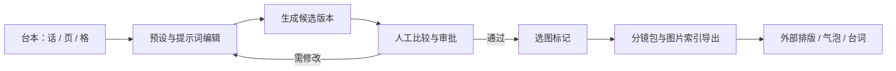
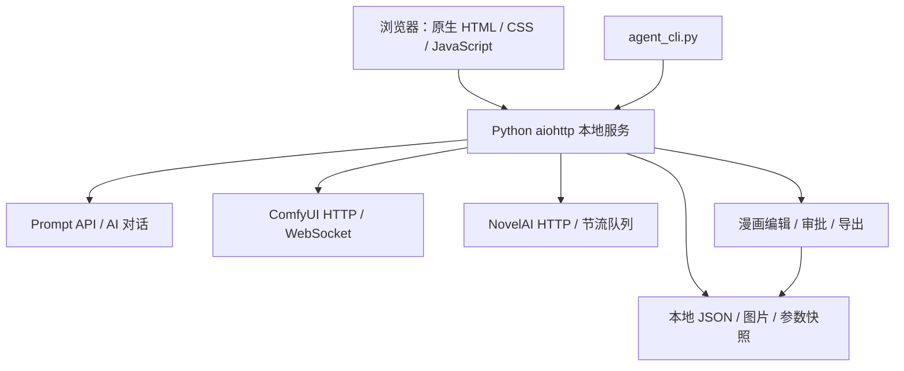

# 绘境 · Local Image Studio

**从一句画面描述，到可追溯的漫画分镜。**


> 上图为 AI 生成的概念宣传插画，不是软件界面截图，也不代表 ComfyUI 或 NovelAI 的实际出图效果。

绘境是运行在本机浏览器里的中文绘图工作台。将 **ComfyUI 本地工作流、NovelAI 在线生图、提示词预设、人物库和漫画编辑审批** 放在同一个创作空间中。界面按绘图引擎分开，生成记录保留实际提示词、参数和图片版本，方便人和 Agent 接力制作。

## 可以做什么

| 功能 | 使用方式 |
| --- | --- |
| ComfyUI 生图 | 导入 API 格式工作流、设置节点映射和参数，用已有模型生成图片 |
| NovelAI 生图 | 分开编辑画风、任务、场景、动作；支持最多 5 个独立角色及角色追加词、负面词 |
| 提示词预设 | 分类保存原文，正负词独立插入，保留权重和特殊符号，调整模块优先级 |
| AI 提示词对话 | 配置 OpenAI 兼容文字 API 和系统预设，自然语言生成提示词并填入输入栏，可撤销 |
| 人物库 | 管理固定外形、默认服装、别名与负面词，支持搜索和分页 |
| NAI 重绘 | 从已有生成图片进入图生图，调整 Strength，保留原图与新版本 |
| 漫画编辑站 | 按话／页／格编排台本，编辑对白、镜头说明，增删和调整顺序 |
| 人工审批 | 按格比较候选图，修改参数生成新版，上传图片归档，标记通过版本 |
| 历史管理 | 分页、日期和作品标签筛选，查看参数及生成结果 |
| 导出与 Agent | 导出分镜包及通过图片索引，通过本地 CLI 查询、提交和下载任务 |

**预设原文追加不调用 LLM。** 只有主动使用 AI 对话或提示词生成时，才调用配置的文字服务；聊天本身不会自动触发生图。

## 快速开始

建议使用 **Python 3.11 或更新版本**；当前主要在 Windows / ComfyUI 便携环境验证。需要准备自己的 ComfyUI 或 NovelAI 访问凭据。仓库不包含模型、API 密钥或个人生成记录。

### 独立启动

```powershell
git clone https://github.com/blindvido/LocalImageStudio.git
cd LocalImageStudio
py -3 -m venv .venv
.\.venv\Scripts\python.exe -m pip install -r requirements.txt
.\.venv\Scripts\python.exe studio_server.py --port 8190
```

浏览器打开 **http://127.0.0.1:8190**。服务运行在当前终端，按 `Ctrl+C` 退出；关闭浏览器不会停止服务。

### 配合 ComfyUI 便携版

将仓库放在 `ComfyUI_windows_portable/local-image-studio/`，与 `python_embeded/`、`ComfyUI/` 同级。已有环境具备所需依赖时运行 `launch.ps1`，或：

```powershell
..\python_embeded\python.exe -X utf8 agent_cli.py start
```

如果缺少依赖，使用该 Python 安装 `requirements.txt`。独立安装时，先自行启动 ComfyUI；自动启动和离线图片回读功能依赖便携版的目录结构。

### 第一次配置

1. **ComfyUI：** 在连接设置填写地址（默认 `http://127.0.0.1:8188`），选择自己已安装的模型，导入 **API 格式 JSON** 工作流。普通画布 JSON 不能直接使用。
2. **NovelAI：** 填写服务地址、凭据和可用模型。服务权限、计费及模型支持以你的服务端为准。
3. **AI 提示词：** 如需自然语言对话，填写 OpenAI 兼容 Chat Completions 地址、密钥和模型。NovelAI 对话和原有 Prompt API 共用连接设置。
4. 手动检查最终正负提示词及参数，再点击生成。配置可以只启用所需的绘图引擎。

## 漫画制作流程



原图与新版分别保存。审批以人工选择为准，不自动把新图视为通过。分镜包可配合 [ComicStoryboardImagePipeline · 漫画分镜出图与排版 Skill](https://github.com/blindvido/ComicStoryboardImagePipeline) 使用；后续拼版与台词排版由外部工具完成，绘境不内置 Pedit。

### 配合漫画分镜 Skill

[ComicStoryboardImagePipeline](https://github.com/blindvido/ComicStoryboardImagePipeline) 是可选的 Agent 协作层：读取已确认台本与 `memory.md`，由 Agent 编写模块化提示词，通过绘境顺序生图，记录实际 Prompt、Seed 和图片版本，再依据人工通过的图片使用 Pedit 排版。

1. 在绘境漫画编辑站编辑台本、页和格，导出 **Skill 分镜包**。
2. 按 Skill 仓库说明安装，让 Agent 读取导出包及项目记忆，明确本次处理范围。
3. Agent 先归档提示词，再通过绘境预览实际请求并提交；使用该流程时 `use_api:false`，避免二次转换提示词。
4. 用户在绘境逐格选定通过图片；Agent 读取 `/api/comic-review/selection` 后进行后续拼版，不擅自选择最新版。

绘境负责生图、历史和审批；Skill 负责执行约定与版本归档；用户负责导演判断。绘境审批不会自动同步项目记忆或 Skill 的反馈记录。Skill、Pedit 及所引用的外部提示词技能需分别安装，详见 [联动说明](https://github.com/blindvido/ComicStoryboardImagePipeline#在绘境中配合使用)。

## 架构概览



没有前端构建步骤，也不依赖云端数据库。模块职责和数据流见 [架构说明](docs/architecture.md)，操作要点见 [使用指南](docs/usage.md)。

## 数据与能力边界

- `data/config.json` 在本机明文保存服务密钥；整个 `data/` 已被 Git 忽略。备份可保留该目录，对外分享务必去除密钥。
- 本地服务只绑定 `127.0.0.1`，写请求使用本机会话令牌。它不是面向公网的多租户服务，请勿直接暴露公网。
- 调用外部服务时，相关提示词以及图生图／视觉输入图片会发送到配置的服务端；“本地工作台”不代表所有推理都在本地。
- NovelAI 请求沿用现有约 25 秒间隔和每日计数，不新增硬性日额度。个人使用建议 V5 每日不超过 400 张；这不是对官方套餐额度的承诺。
- 人物分段和预设有助于控制内容，不保证角色一致性或动作准确。图片参考功能是否参与请求应以实际接口和请求预览为准，不能将保存参考图视为已启用风格／角色参考。
- 局部改图依赖 ComfyUI 的 SAM3.1 等节点和对应模型；仓库不会自动下载模型或安装节点。
- 项目仍在迭代，当前没有声明开源许可证；公开源码不等于已授予任意再分发许可。

## 灵感与致谢

绘境的创作流程与工作流占位符约定受到 **智绘姬插件** 的启发。感谢智绘姬提供的设计思路：将自然语言描述、提示词整理和绘图工作流串联起来。绘境的核心服务与界面为独立实现，不依赖安装智绘姬或酒馆即可运行。

## 开发与验证

```powershell
python -m unittest discover -s tests -v
```

测试使用临时数据和模拟上游，不需要付费生图。与可选外部分镜 Skill 关联的集成测试需单独安装该 Skill。更多细节见 [架构说明](docs/architecture.md)。

遇到问题请附上操作步骤、脱敏错误信息及参数，不要上传 `data/config.json` 或 API 密钥。
